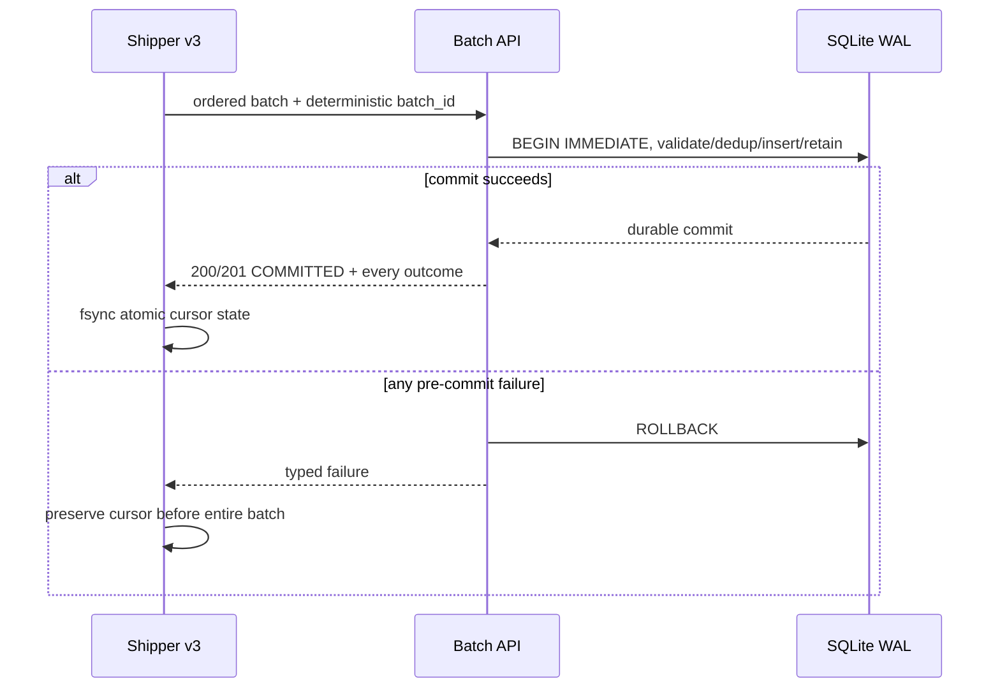

# M18 atomic batch protocol

The new endpoint is `POST /api/v1/events/ingest-batch`. It is protected by the
existing machine `X-API-Key`, is disabled by default, and does not alter human
session, CSRF, Origin or RBAC behavior.

```json
{
  "protocol_version": "m18-batch-v1",
  "batch_id": "m18-device-inode-offset-digest",
  "events": [{"timestamp": "2026-10-15T05:00:00Z", "id": "source-id"}]
}
```

Limits are explicit: 100 events, 2 MiB request by default, the existing bounded
per-event size, 15-second pre-commit deadline, one synchronous outstanding
request, and strict envelope fields. Values are configurable only inside hard
caps of 100 events, 8 MiB request and 60 seconds.

## Success contract

```json
{
  "protocol_version": "m18-batch-v1",
  "batch_id": "m18-device-inode-offset-digest",
  "status": "COMMITTED",
  "atomic": true,
  "inserted": 1,
  "duplicates": 1,
  "results": [
    {"index": 0, "event_id": "a", "deduplication_id": "…", "outcome": "INSERTED"},
    {"index": 1, "event_id": "b", "deduplication_id": "…", "outcome": "DUPLICATE"}
  ],
  "timing_ms": {"request_parse_ms": 0, "normalization_ms": 2,
    "database_ms": 10, "transaction_ms": 9, "retention_ms": 3,
    "commit_ms": 1, "total_ms": 12}
}
```

HTTP 201 means at least one INSERTED item. HTTP 200 means every item was a
DUPLICATE. The shipper validates protocol version, batch ID, result ordering,
counts, atomic marker and the HTTP/status relationship before advancing.

## Failure contract and durability

Outcomes are `INSERTED`, `DUPLICATE`, `PERMANENTLY_INVALID`,
`RETRYABLE_FAILURE`, and `NOT_PROCESSED`. A failed batch never returns a
successful item outcome. An invalid middle item identifies that index and marks
the others NOT_PROCESSED. Busy, timeout and database failures classify every
item RETRYABLE_FAILURE.



No acknowledgement is emitted before commit. A network timeout after commit is
ambiguous by design: the cursor stays put, the deterministic whole batch is
retried, and indexed idempotency returns DUPLICATE for committed items. A
malformed success response is a protocol error and also preserves the cursor.
Filtered/malformed records preceding a retry gap are not durably counted until
the contiguous batch acknowledgement succeeds.

The original `/api/v1/events/ingest` endpoint and single-event v3 behavior are
unchanged and remain the default fallback.
